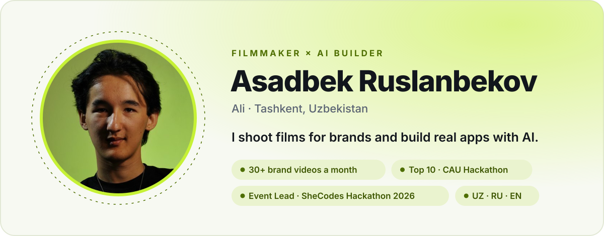
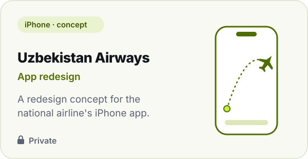
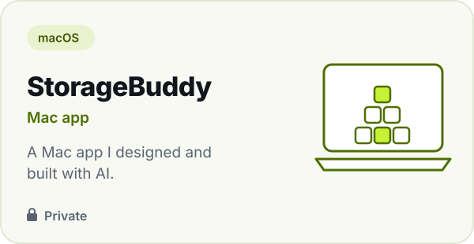
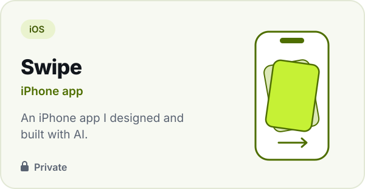
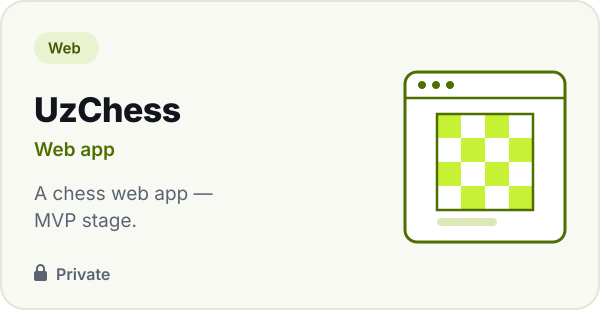
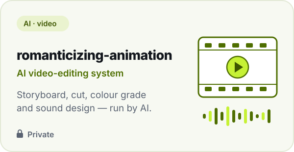
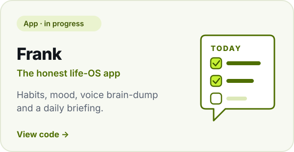
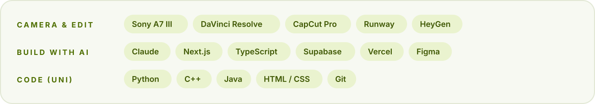

<picture>
  <source media="(prefers-color-scheme: dark)" srcset="assets/hero-dark.svg">
  
</picture>

  <a href="https://www.youtube.com/@romanticizing_this_life"><picture><source media="(prefers-color-scheme: dark)" srcset="assets/link-youtube-dark.svg"></picture></a>
  <a href="https://t.me/asadbekruslanbekov"><picture><source media="(prefers-color-scheme: dark)" srcset="assets/link-telegram-dark.svg"></picture></a>
  <a href="https://t.me/delay_sam_s_AI"><picture><source media="(prefers-color-scheme: dark)" srcset="assets/link-ai-group-dark.svg"></picture></a>
  <a href="https://www.linkedin.com/in/asadbek-ruslanbekov-0a9a0429a"><picture><source media="(prefers-color-scheme: dark)" srcset="assets/link-linkedin-dark.svg"></picture></a>
  <!-- Portfolio website: when it's live, wrap the next image in <a href="https://YOUR-SITE"> … </a> -->
  <picture><source media="(prefers-color-scheme: dark)" srcset="assets/link-website-dark.svg"></picture>

  <b>Now →</b> shooting &amp; editing 30+ brand videos a month · building apps with AI · CS student at Webster University (exchange at Leiden)

 

## Things I've built

  <picture><source media="(prefers-color-scheme: dark)" srcset="assets/card-airways-dark.svg"></picture>
  <picture><source media="(prefers-color-scheme: dark)" srcset="assets/card-storagebuddy-dark.svg"></picture>
  <picture><source media="(prefers-color-scheme: dark)" srcset="assets/card-swipe-dark.svg"></picture>
  <picture><source media="(prefers-color-scheme: dark)" srcset="assets/card-uzchess-dark.svg"></picture>
  <picture><source media="(prefers-color-scheme: dark)" srcset="assets/card-romanticizing-dark.svg"></picture>
  <a href="https://github.com/ali-aesthetic/frank"><picture><source media="(prefers-color-scheme: dark)" srcset="assets/card-frank-dark.svg"></picture></a>

## Highlights

<table>
  <tr><td>👩‍💻&nbsp;<b>Event Lead</b></td><td>SheCodes Hackathon 2026 — a 24-hour AI × Education hackathon for women in tech</td></tr>
  <tr><td>🏆&nbsp;<b>Top 10</b></td><td>CAU Hackathon</td></tr>
  <tr><td>🩺&nbsp;<b>Coalition AI</b></td><td>Dermatoscopy analyzer built at the AI in Healthcare Hackathon 2026 · <a href="https://github.com/ali-aesthetic/coalition-ai">code</a></td></tr>
  <tr><td>🎬&nbsp;<b>Brand films</b></td><td>Bentley Hotel · Flame Restaurant · Medion Clinic</td></tr>
  <tr><td>✍️&nbsp;<b>Co-founder</b></td><td>Webster Poetry Club (100+ members) and the Filmmaking &amp; Photo Club</td></tr>
</table>

## Toolbox

<picture>
  <source media="(prefers-color-scheme: dark)" srcset="assets/toolbox-dark.svg">
  
</picture>

Tashkent · Uzbek / Russian / English · portfolio website coming soon

